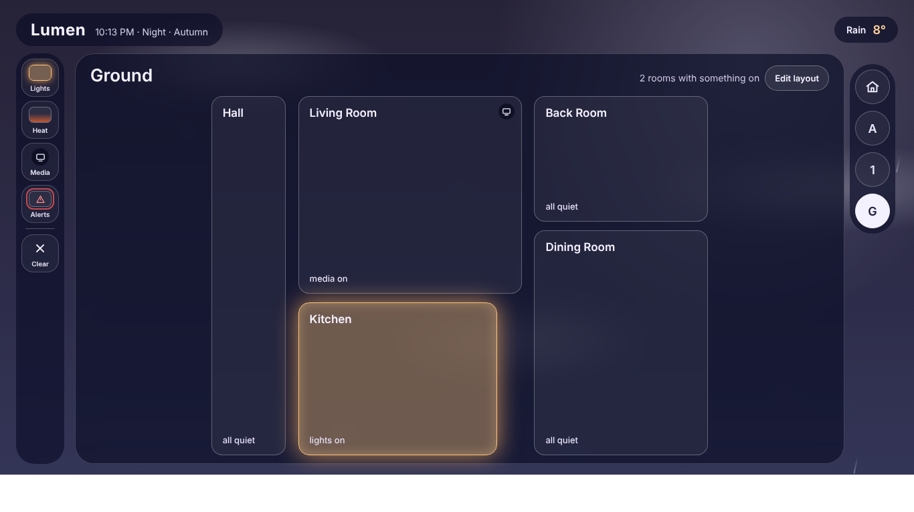

# Lumen

A living-sky dashboard card for Home Assistant.

Lumen shows your whole house as glowing floors stacked on top of each other. Rooms light up when their lights are on, turn warm when they're heating and cool when they're cooling, and every room shows its temperature. Behind it all, the sky follows the real sun and weather: dawn, midday, sunset and night, plus rain, snow, fog, wind and the seasons.


## What it does

- **Whole house at a glance.** Every floor, every room, with a glow for lights and a tint for heating or cooling.
- **Tap to go deeper.** House, then room, then device, with full controls for heating dials and lights (brightness, warm or cool white, colour).
- **Draw your rooms.** Open a floor, tap **Edit layout**, then drag and resize the rooms to match your home. Overlaps turn red. Saving shares the plan with every screen. Only admins see the button.
- **Device rail.** Buttons for Lights, Heat, Media, Alerts and the rest open a list of every device of that type, with **All off**.
- **Wall screens.** Add `?kiosk` to the dashboard address to hide Home Assistant's menus.

| Floor plan | Drawing rooms | Lights list |
|---|---|---|
|  |  |  |

## Before you start

Lumen builds itself from Home Assistant's **floors** and **areas**, so set those up first:

1. Go to **Settings → Areas, labels & zones**.
2. Add your floors (Ground, First, Attic and so on).
3. Put each room (area) on its floor.
4. Put your devices in their rooms.

## Install

### Marketplace

Coming soon.

### By hand

1. Download `dist/lumen-card.js`.
2. Copy it into your Home Assistant `config/www/` folder.
3. Go to **Settings → Dashboards → ⋮ → Resources** and add `/local/lumen-card.js` as a **JavaScript module**.
4. Make a new dashboard, choose the **Panel** view type, and add this card:

```yaml
type: custom:lumen-card
```

## Options

```yaml
type: custom:lumen-card
effects: balanced   # subtle, balanced or showy: how much the sky moves
kiosk: false        # true hides Home Assistant's menus on this screen
```

Room drawings are saved into the card as `layout:` by the **Edit layout** button. You don't need to type them.

## Testing

The `test/` folder has a pretend house (`test.html`) and scripts that drive it with Playwright:

```bash
cd test
node shot.js
```

## Support

Lumen is free. If it brightens your home, you can buy me a coffee (link coming soon).

---

Made by [rmclynch](https://github.com/rmclynch), with a nod to TelemIoT.
